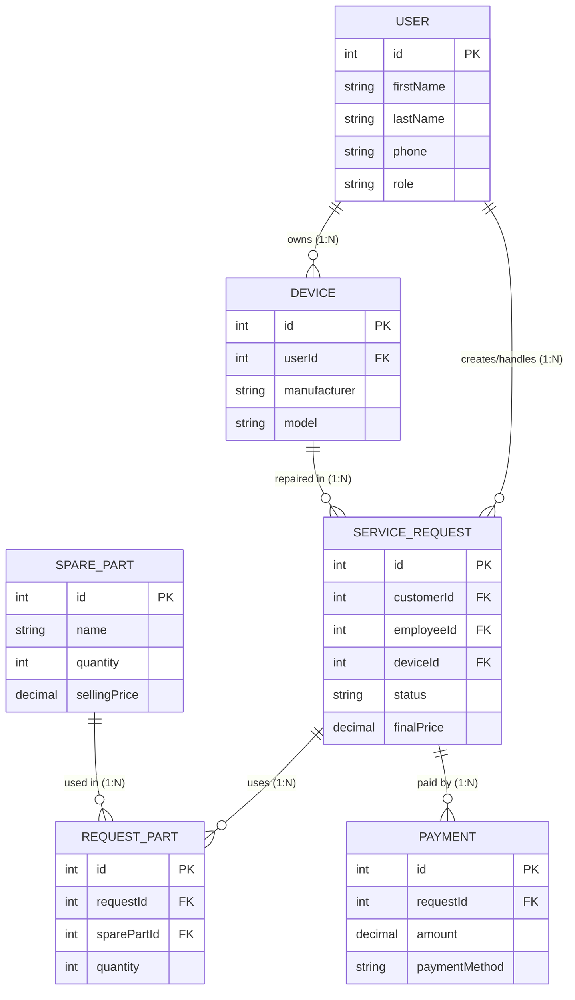

# pazc
### Diagram:

===============================================

### Prepojenie databázových tabuliek s GUI okna

1. **`MainDashboard.fxml` (Hlavné okno)**
   * **Záložka „Servisné požiadavky“:**

     `ServiceRequest` — načítanie zoznamu požiadaviek a ich stavov.

     `User` — zobrazenie mena zákazníka (`customerId`) a priradeného zamestnanca (`employeeId`).

     `Device` — zobrazenie informácií o opravovanom zariadení (`deviceId`).
   * **Záložka „Sklad náhradných dielov“:**

     `SparePart` — načítanie zoznamu dielov, ich množstva (`quantity`) a cien.
   * **Záložka „Zákazníci a zariadenia“:**

     `User` — zobrazenie zoznamu používateľov s rolou `CUSTOMER`.

     `Device` — zobrazenie zariadení priradených k jednotlivým zákazníkom (`userId`).

2. **`RequestEdit.fxml` (Modálne okno detailu požiadavky)**

   `ServiceRequest` — úprava stavu (`status`), diagnostiky (`diagnosis`), priradenia zamestnanca (`employeeId`) a finálnej ceny (`finalPrice`).

   `RequestPart` — pridávanie a odoberanie použitých dielov pre danú požiadavku (`requestId`).

   `SparePart` — načítanie dostupných dielov zo skladu a aktualizácia ich množstva pri použití.

3. **`NewRequest.fxml` (Modálne okno novej požiadavky)**

   `ServiceRequest` — vytvorenie nového záznamu v databáze.

   `User` — výber existujúceho zákazníka (`customerId`) alebo vytvorenie nového.

   `Device` — výber zariadenia (`deviceId`) priradeného k zákazníkovi alebo zaevidovanie nového zariadenia.

4. **`PaymentDialog.fxml` (Modálne okno platby)**
   
   `Payment` — vytvorenie nového záznamu o platbe (`amount`, `paymentMethod`, `paymentDate`).
